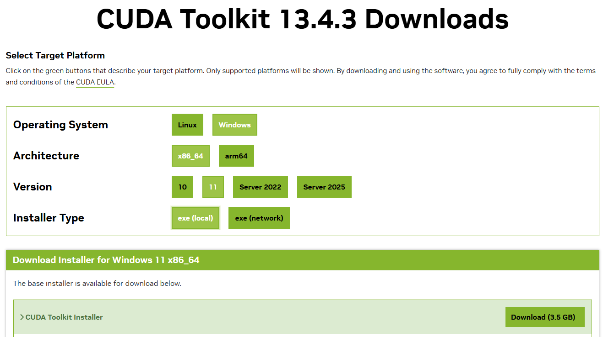
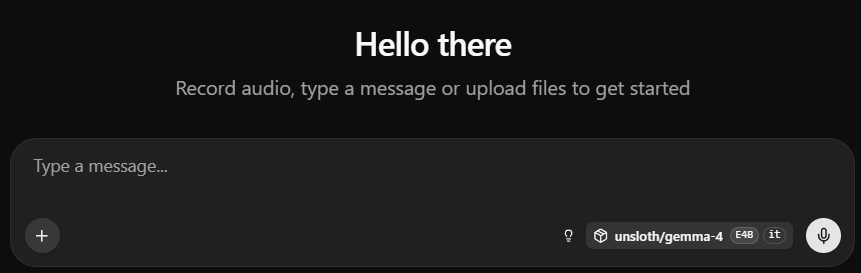
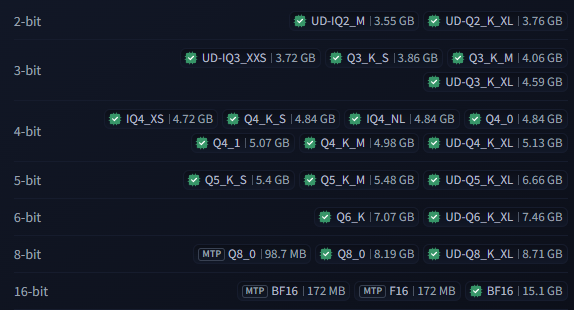
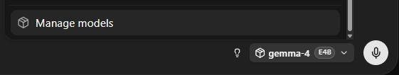
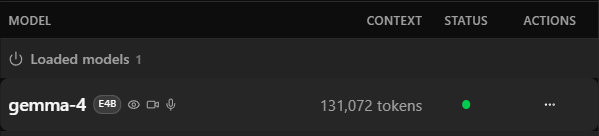
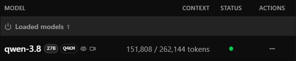
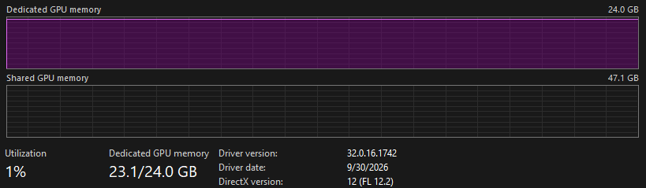
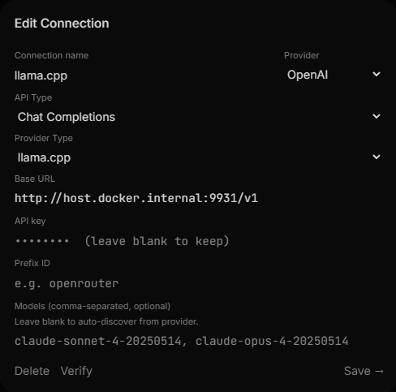
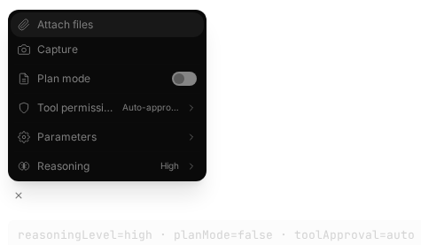

Trials and tribulations of setting up local LLM AI. Treat this as a comprehensive guide to running local AI models.

<!-- end -->

# Preamble

As a software engineer, I'll admit I'm definitely late to the AI train when it comes to AI-assisted coding. Being in the indie game development space, I held pretty strong opinions against AI meddling in any of my work. Surprisingly, I actually enjoy the process of coding. However, AI has gotten far too powerful to ignore at this point, so it's about time I try tinkering with its workflows. That being said, I'm not a fan of the practices behind giant AI companies, so I'd rather evaluate the capabilities of local AI models that can leverage my own hardware and keep my data private. Plus, I can switch out whatever models I want, granted they fit in my system.

This excursion was largely inspired by this YouTube video: [STOP. You're Installing Local AI Right Now (Llama.cpp)](https://www.youtube.com/watch?v=ydFikMBJG1g), so the tech stack and models I'll be using will mostly parallel that video, but I'll go more in-depth about the exact CLI commands and flags and their effects. In fact this article will capture my entire investigation into local AI so far, so hopefully it can build better knowledge around how to properly setup local AI rather than just "this works".

Also this entire article is human written by me, Ricimon. You as the reader should deserve that.

# Getting Started With Llama.cpp

The first step is to select the inference engine that will run the AI models, and just have them function as a simple chatbot. Everything used will be open-source to provide the most options behind privacy control and software customization. For this, I selected [llama.cpp](https://github.com/ggml-org/llama.cpp), as it is the lightest engine option with the most customization potential (most configuration is done through the CLI). In fact, many other inference engines with fancy UIs just use llama.cpp as their backend.

Llama.cpp does have release binaries and fast shell install scripts, but I wanted to be more explicit with what commands I'm running to install, so I opted to build from source. Llama.cpp has [build docs](https://github.com/ggml-org/llama.cpp/blob/master/docs/build.md) that describe how to build for all sorts of devices. I have an NVIDIA GPU so I'll be following the CUDA build path. Running inference on the GPU gives a massive speed improvement over the CPU and is consequently why GPU prices are in the stratosphere. I'm running on a Windows machine so I'll be installing CUDA from [NVIDIA's website](https://developer.nvidia.com/cuda/toolkit):

<div align="center">
    <p style="max-width:600px">
        
    </p>
</div>

The next CLI dependencies needed are **CMake**, to compile llama.cpp source code, **Ninja**, to significantly increase compilation speed through parallelization, **Ccache**, for faster repeated compilation, and **OpenSSL**, to let llama.cpp be able to pull models from Hugging Face repos. I installed all of these through a Windows package manager, [Chocolatey](https://chocolatey.org/):  
`choco install cmake ninja ccache openssl`

*I opted not to run the llama.cpp backend through Docker as the setup would've been more complicated to maintain and may perform poorer with more scaffolding between software and hardware. The inference engine itself also won't affect any system files as it's just an input-output machine.*

For Windows, compilation and run must be performed in a Developer Command Prompt / PowerShell for VS2022, is what the build documentation says. I have Visual Studio Community 2026 installed, so in Visual Studio Installer I installed the extra tools of "Desktop-development with C++", "C++-CMake Tools for Windows", "Git for Windows", "C++-Clang Compiler for Windows", and "MS-Build Support for LLVM-Toolset (clang)". I'm also using [Windows Terminal](https://learn.microsoft.com/en-us/windows/terminal/install), and it auto-added a "Developer PowerShell for VS 18" as a profile option. Running the follow commands in this terminal worked for me.

*[PowerShell fzf](https://github.com/kelleyma49/PSFzf) is an extremely useful plugin to work with the PowerShell command line. You could try asking your LLM how to properly install this and setup its `ctrl+r` command history search keybind once you have a simple chatbot working.*

Now with the llama.cpp repo cloned, compilation can begin with creating the Makefile. Run this in PowerShell:  
```sh
cmake -B build -G Ninja -DGGML_CUDA=ON -DLLAMA_OPENSSL=ON -DCMAKE_BUILD_TYPE:STRING=Release
```
`-B build` places the build directory in the `build/` folder, `-G ninja` specifies the build system to use Ninja, and the other flags enable their corresponding features.

Next, run the compilation:
```sh
ninja -C build
```
After this operation, a collection of `llama-*.exe` files should be present in the `build/bin/` folder.

Since we're going to use llama.cpp as a backend, `llama-server.exe` will work perfectly for our use case. This executable will run llama.cpp in router mode, which allows different AI models to be loaded and unloaded on demand, and exposes a port for frontend applications to connect to. It also happens to have a nice HTTP web UI to get started talking to a model. To see this in action, run the following command:
```sh
.\build\bin\llama-server.exe -hf unsloth/gemma-4-E4B-it-GGUF
```
This will start up the llama.cpp backend with a single model to serve: Google's Gemma 4 E4B, which llama.cpp will automatically download from the Hugging Face repo: https://huggingface.co/unsloth/gemma-4-E4B-it-GGUF. On Windows, this download will go into `C:\Users\<user>\.cache\huggingface\hub\models--unsloth--gemma-4-E4B-it-GGUF\`.

Running this command shows what port the llama.cpp server has bound to, and you can now visit that port in your browser to use the aforementioned web UI. As of writing, the default port is 9931, so visit `http://localhost:9931` in your browser.

<div align="center">
    <p style="max-width:600px">
        
    </p>
</div>

Here, you can now talk to your local AI! To see its resource usage in action, open up the Windows Task Manager, go to the Performance tab, and click on your primary GPU. When the inference engine is running, your llama.cpp command should also output token generation stats such as token input processing speed and output token generation speed.

At this point, you'll just have a simple chatbot that only has the context of the conversation you're currently having with it. Before increasing its capabilities, I'll go over the details about the model you just downloaded and other model options to try.

# AI Models

This part can get really in-depth and can fall into the realm of frontier AI research, so I'll just be covering basic information needed to get a high-level understanding of local AI models.

As mentioned, the simple model you just downloaded is Google's Gemma E4B. Detailed documentation for Gemma 4 can be found [here](https://gemma.ai/models/gemma-4/model-card/), but I'll summarize. The signifier "#B" stands for # billion of parameters, so in this case 4 billion parameters; generally the higher the parameter count, the bigger and smarter the model becomes. Here the "E" in "E4B" stands for "effective" parameters, which Google has specifically designed the model for to maximize model efficiency for its size.

It lives in Unsloth's repo because the Unsloth company has created the GGUF quantizations of the Gemma 4 model needed to run on llama.cpp. That's what the GGUF signifier is for. In a nutshell, GGUF is a standarization of model files that combine the tensors and metadata of an AI model into a single file for faster loading, and is what llama.cpp requires to run. If you take a look at this model's [repo](https://huggingface.co/unsloth/gemma-4-E4B-it-GGUF) in Hugging Face, you'll see that there's a bunch of different GGUF variations with different tags and sizes.

<div align="center">
    <p style="max-width:600px">
        
    </p>
</div>

These are the various quantization levels of the model. Quantization reduces the precision on model parameters to cut down on model size. Normally model parameters are encoded in 16-bit floating point numbers (designated by F16). By reducing that precision down to 8 bits, or 4 bits, the model size gets drastically reduced without too much degradation in intelligence. The level of bit-reduction and quantization type is denoted in the tag. A tag of `Q4_K_M` means 4-bit K-quant with medium-level precision. You don't have to know what all that means. It's generally agreed upon that `Q4_K_M` is the best bang-for-your-buck when it comes to retaining intelligence while reducing model size. When passing a Hugging Face repo to llama.cpp, you can specify what tagged model you want to use. For example,
```sh
.\build\bin\llama-server.exe -hf unsloth/gemma-4-E4B-it-GGUF:Q8_0
```
will use the `Q8_0` tag (or the first model file it finds tagged with `Q8_0` if there are multiple files with the same tag). When a tag isn't present, llama.cpp will default to searching for the `Q4_K_M` tag.

For fast GPU inference, the model you chose will need to fit inside your GPU's VRAM. But, you can't just pick a model that's exactly the size of your VRAM, as you'll need leftover space for context (and because your OS itself will consume some amount of VRAM). I'll explain more about context later.

The `it` signifier stands for "instruction tuned", and it just means the model is fine-tuned on instruction-response pairs, and more reliably follows user prompts such as "Summarize this", or "Write a function that does _". Pretty much all the popular models are fully capable and reliable with following instructions anyways, so it doesn't really matter if this signifier doesn't appear in a model name.

All of the models I've discovered come from [Unsloth's website](https://unsloth.ai/docs), as they've done a great job with creating GGUFs and benchmarks for many local AI models. However a lot of models on their list need hundreds of GB to run, so I've distilled down a list of models that reasonably fit on consumer grade GPUs:

- [Qwen3.8-27B](https://huggingface.co/unsloth/Qwen3.8-27B-GGUF) (`UD-Q4_K_M`: 16.5GB / 17.9GB MTP)
    - This is the one I've used by far the most. It is seriously impressive. At the time of writing, this is the latest Qwen model small enough to fit on consumer grade GPUs. If you can fit a reasonable quant of this model into your GPU VRAM, give it a try. Most rankings will place Qwen3's coding capabilities above that of Gemma 4.
- [Gemma 4 26B-A4B](https://huggingface.co/unsloth/gemma-4-26B-A4B-it-GGUF) (`UD-Q4_K_M`: 16.9GB)
    - This model uses a Mixture-of-Experts (MoE) design to only activate a 4B subset of parameters during inference, which should let it run almost as fast as a 4B-parameter model. In general, Gemma 4 performs better at general knowledge and chatting over Qwen3 models.
- [Gemma 4 31B](https://huggingface.co/unsloth/gemma-4-31B-it-GGUF) (`Q4_K_M`: 18.3GB)
    - This is a smarter model compared to Gemma 4 26B-A4B, but it does demand more VRAM.
- [Gemma 4 12B Unified](https://huggingface.co/unsloth/gemma-4-12b-it-GGUF) (`Q4_K_M`: 7.12GB)
    - I haven't tried this one but it looks decent for the 12GB VRAM space. The "Unified" means image and audio input go directly into the LLM's embedding space rather than passing them through dedicated encoders first. This supposedly improves multimodal input latency.
- [Qwen3.5-9B](https://huggingface.co/unsloth/Qwen3.5-9B-GGUF) (`Q4_K_M`: 5.7GB)
    - I haven't tried this one but it is a small-scale Qwen model, so might as well try it if you're on like a 8GB VRAM setup.
- [Gemma 4 E4B](https://huggingface.co/unsloth/gemma-4-E4B-it-GGUF) (`Q4_K_M`: 4.98GB)
    - This is the model you loaded to quickly get set up. It's a good fallback to quickly load for testing the llama.cpp setup.
    
As you can see the list is all Qwen3 or Gemma 4 models, and as far as I can tell, it's because it's just Alibaba (Qwen) and Google (Gemma) that are recently targeting the consumer GPU use case. If you're reading this more than a couple months after the time of writing, do some research into the latest small-scale local AI models. I'm sure this space will improve very fast.

The `UD-` signifier in front of the quantization tag stands for `Unsloth Dynamic`, which is Unsloth's own special quantization method that providers better accuracy at the same model size. `MTP` stands for Multi-Token Prediction, which is a model that supports predicting multiple upcoming tokens at once instead of generating one token per step. This can increase token generation speeds from ~1.4x to 2.2x faster, at the cost of a slightly larger model size. In my own testing, under normal conditions the regular Qwen3.8-27B model generates at about 40 tokens per second while the MTP-enabled version generates at about 60 tokens per second. In my opinion it's very worthwhile to use an MTP-model if available, and I'll explain more about its setup later.

# Model Configuration For Llama.cpp

If you're following along, pick a model quant that gives you 3-10GB of leftover room in your VRAM. For my setup, I have 24GB of VRAM available so I picked the Qwen3.8-27B `Q4_K_M` quant (no MTP yet). Windows itself consumes about 2GB of VRAM, leaving me with 5.5GB leftover. This leftover space will be used for the context.

The context of a model is the space where tokenized input and output are stored for the inference engine to run against. Ideally this is all stored in VRAM because inference will operate on all these values just as much as the model parameters. But if you've heard that models get dumber the longer you talk to them, that's because their context starts filling up, and beyond a certain point there's just too much context to process through, and reasoning breaks down. Every model provides a default maximum context length for reasonable performance. For Qwen3.8-27B, that number is 262,144 tokens. However, with the VRAM headroom I suggested, you won't have enough VRAM space to fit that many context tokens. The smaller the context though, the less information the model will be able to hold in its attention. So the next step will be to figure out how much context can be squeezed in with the VRAM space left.

Back to the `llama-server.exe` command, I mentioned this starts the server in router mode, allowing different models to be loaded and unloaded on demand. The way to declare the available models is through the use of a `preset.ini` file. Make a `preset.ini` file in the `models/` folder inside the llama.cpp folder (because `models/` is git-ignored), and the following command will load this file:
```sh
.\build\bin\llama-server.exe --models-preset .\models\preset.ini --models-max 1
```
The `models-max` parameter declares that only up to 1 model can be loaded at a time, which will auto-unload the current model if a different model is requested. This is also the only parameter that can't go inside the `preset.ini` file. Without this parameter, llama.cpp will stall out if you try to load a second model that can't fit in memory.

Inside of this `preset.ini` file, you can declare global and per-model arguments. I'll show all the relevant parts of my `preset.ini` then explain each argument.

```ini
[*]
parallel = 1
cache-ram = -1
cache-type-k = q8_0
cache-type-v = q8_0
jinja = true
threads = 12
threads-batch = 12
n-gpu-layers = -1
kv-offload = 1
flash-attn = true

[qwen-3.8-27B-Q4KM]
hf = unsloth/Qwen3.8-27B-GGUF:UD-Q4_K_M
# measured
ctx-size = 140000
temp = 1.0
top-p = 0.95
top-k = 20
min-p = 0.0
image-min-tokens = 1024

[gemma-4-E4B]
hf = unsloth/gemma-4-E4B-it-GGUF
temp = 1.0
top-p = 0.95
top-k = 64
```

Arguments under `[*]` are global. `parallel = 1` states that only 1 inference operation can happen at a time. We're maximizing our GPU usage on a single model and inference, so this is necessary. `cache-ram = -1` specifies that llama-server's prompt cache does not have a limit. How this works is that upon sending a prompt, the inference engine must first tokenize your prompt and store its tokenized state into the KV cache. The prompt cache is an in-RAM store that keeps a copy of the prompt KV state so that when the same prompt appears, prefill does not need to run again. This should result in a much faster time-to-first-token when running long agentic flows. Despite setting this to unlimited, I haven't seen issues with running out of system RAM.

## The KV Cache

The next two arguments, `cache-type-k` and `cache-type-v` merit their own explanation section. KV cache stands for "Key-Value cache", and it's what holds the context of the AI model. Just like model parameters, these are stored numerical token values. By default, they're floats stored with 16-bit precision, and just like with the model, we can reduce the precision on these numbers to reduce their size. However, KV cache values are more sensitive to precision loss, so it's generally agreed that a reduction to 8-bit is as much as you should go, or else the model will start forgetting or hallucinating its memories. Therefore, these two parameters set that the key and value numbers in the KV cache should be quantized to 8 bits, effectively doubling the context size as compared to no-KV-quantization.

I mentioned that ideally the context / KV cache should all be in VRAM, but it is possible to bleed the KV cache into RAM if the cache is too big. The exact mechanism depends on an NVIDIA Control Panel setting, but the result is still significant token generation slowdown, as running inference will require constant shifting of data between VRAM and RAM. Speaking of the setting, it's the "CUDA - Sysmem Fallback Policy" under "Manager 3D settings" in the NVIDIA Control Panel. I recommend having it set to "Prefer No Sysmem Fallback" for specifically the `llama-server.exe` executable. This should help in removing possible RAM space visible to llama.cpp for KV cache allocation.

Back to the arguments, `jinja = true` enables the Jinja template engine for GGUF models that have an embedded Jinja chat template, which is pretty much all of them. It's what enables models to create tool calls (like `read_file`) and produce reasoning. `threads = 12` and `threads-batch = 12` sets the number of CPU threads used for input prompt processing, which some amount of happens on the CPU. This number should be set to the number of physical cores your CPU has. `n-gpu-layers = -1` specifies how many AI model layers should be offloaded to the GPU for processing, and "-1" specifies all of them. We want to run full GPU inferencing, so this will place the entire AI model in the GPU. `kv-offload = 1` specifies that the entire KV cache should be offloaded to the GPU. Setting this option to false will actually place the entire KV cache in RAM and result in partial CPU inference (very slow, not good). `flash-attn = true` changes internal attention computation to a more efficient version, and is required to be on when using KV cache quantization.

Moving on to the next sections, each `[...]` section defines a model option, and arguments underneath each correspond only to that model. The `hf` parameter specifies the Hugging Face repo name to pull the model from and the tag to pull. You'll always be able to navigate to the Hugging Face repo on the web by going to `https://huggingface.co/<hf argument without the tag>`. As mentioned before, if there are multiple models with the same tag, llama.cpp will pull the first one found. To disambiguate this, remove the tag from the `hf` argument, and add a new argument for the exact GGUF file name, ex. `hff = Qwen3.8-27B-UD-Q4_K_M.gguf`. `temp`, `top-p`, `top-k`, and `min-p` are tuning parameters for the model runtime. Both Hugging Face repo model cards and Unsloth docs have good numbers to set these to. `image-min-tokens` is a Qwen3-specific parameter that llama.cpp spits out a warning for if not set.

## Sizing the Context

`ctx-size` sets the token size of the context. When this argument is omitted, llama.cpp will try to auto-size the context according to your available VRAM, but I've always found that llama.cpp will oversize. It's a good starting point though to self-measure a suitable context size. To measure this size, first ensure no GPU-heavy applications are running, then start up llama-server with the arguments and `preset.ini` we have so far. On the web page, go into Manage Models, and load the model you want to size.

<div align="center">
    <p style="max-width:400px">
        
    </p>
</div>

Gemma 4 E4B is small and has a max context size of 131,072 tokens, so its entire max context can be allocated into VRAM.

<div align="center">
    <p style="max-width:400px">
        
    </p>
</div>

Qwen3.8-27B, however, cannot have its entire max context fit, so llama.cpp automatically allocated it 151,808 tokens worth of size.

<div align="center">
    <p style="max-width:400px">
        
    </p>
</div>

If I check my Task Manager GPU stats, I can confirm that my VRAM is filled up, as the entire size of the KV cache is pre-allocated on model load.

<div align="center">
    <p style="max-width:600px">
        
    </p>
</div>

*Llama.cpp will always leave 1GB of headroom unused to keep the system responsive. This can be adjusted with the `fit-target` argument.*

However like I said, I've found this is always oversized. How this manifests is that inference goes fast up until context data overflows the allocated VRAM space, then token generation speeds fall by 90% (40 t/s → 5 t/s) and never seems to recover unless you reboot llama-server entirely. To adjust the context size to fit, set the `ctx-size` parameter to something much lower, for example 80000, and then check VRAM usage after model load. It should hopefully be a number under your VRAM size minus 1GB. Then, just slowly increment the context size number until you hit just slightly below that 1GB headroom ceiling (I went 0.1GB below, so 22.9/24.0 GB on the Task Manager display). For me, my measured `ctx-size` is 140,000 tokens. As a rough estimate for how much of a context that is, 1 token is about 4 characters of English text, or 3 characters of code, so a 100,000 token limit can fit about an entire novel (keep in mind the context contains everything from the prompt to the response, reasoning, and any retrieved documents).

*The command `llama-fit-params.exe` runs the same context fitting operation and prints the calculated context size as output. You have to give it all the model arguments individually though, including KV quantization settings.*

## MTP

As mentioned before, MTP stands for Model-Token Prediction, and is a type of AI model that gives noticeable increases to token generation speed by predicting multiple upcoming tokens at once rather than generating one token per step. MTP models are distributed in 2 ways, as a sidecar file to a primary GGUF, or embedded in the GGUF file itself. The Unsloth Qwen3.8-27B repo is an example of sidecar loading, as there's a `[MTP] Q4_0` tagged file that's only 1.37GB. To enable MTP in this scenario, make the following changes to `preset.ini`:

```ini
[qwen-3.8-27B-mtp-Q4KM]
hf = unsloth/Qwen3.8-27B-GGUF:UD-Q4_K_M
# measured
ctx-size = 105000
spec-type = draft-mtp
spec-draft-n-max = 2
spec-default = 1
temp = 1.0
top-p = 0.95
top-k = 20
min-p = 0.0
image-min-tokens = 1024
```

The `spec-type = draft-mtp` argument enables MTP, and llama.cpp will automatically try to find a `mtp-*.gguf` sidecar file. `spec-draft-n-max` controls the maximum number of tokens to draft per speculative-decoding round. Depending on your AI model and GPU model, there may be benchmark results found online for the optimal number to use, such as [this one](https://github.com/sudoingX/qwen38-mtp). Without one, try testing numbers from 2 to 8; the higher this number, the more tokens predicted, but also the more potential tokens rejected. `spec-default = 1` is the other argument needed to use MTP.

Now in case you want to use a model with embedded MTP heads, which should have the MTP tag but be significantly larger, the `preset.ini` syntax is the same, *unless* the repo it's in also happens to have a `mtp-*.gguf` sidecar file (perhaps for legacy reasons). In this case, you'll have to manually download the model, and point directly to it in `preset.ini`. For example,

```ini
[model-mtp-Q4KM]
model = models/model-mtp.gguf
# ...
```

This is because llama.cpp will always look for that `mtp-*.gguf` sidecar if MTP is enabled, and if the primary model already has the MTP heads, llama.cpp will just error out on trying to load the model.

This increased inference speed does come at a cost of overall model size, so expect your measured context size to be smaller than with a non-MTP model.

## Idle

Lastly, there's an argument I didn't use, and that's `sleep-idle-seconds`. Setting this argument to a number in seconds will cause a loaded model to unload and free up VRAM space when no prompt has been received in that amount of time. It sounds nice to have, but I've found that when the model reloads, llama.cpp doesn't seem to allocate itself enough VRAM and token generation speeds are irrecoverably slowed. So now I just leave the model loaded, and if I need my VRAM back I'll just stop llama-server.

# The Frontend

Now that llama.cpp configuration is complete, we'll need a good frontend application to truly unlock the powers of agentic and RAG (retrieval-augmented generation) workflows. The frontend is what gives the LLM access to tools to browse the web, read a document, edit a file, send a webhook, etc. This is where a lot of the consumer-facing products live, as they'll just connect to a cloud LLM provider in the backend, such as Claude, ChatGPT, etc. One of the ways a frontend application talks to an LLM backend is defined by an OpenAI API ruleset, which llama.cpp of course supports!

For my use case, I wanted an open-source frontend that gave the AI full access to a sandboxed computer, so that it could go wild with whatever tools it needed to complete a task. The strongest tool of course, is shell access. I'll admit I asked my Qwen LLM for suggestions, and it gave me [Open WebUI](https://openwebui.com/), [OpenHands](https://www.openhands.dev/), and [AnythingLLM](https://anythingllm.com/).

I tried all three of them, and of course all three had glaring issues.

- Open WebUI itself is not really a computer-interfacing frontend. It's more of a chat interface with drop-in file support. It does have plugin support with a number of plugins in their hub, but this ultimately didn't really fit my use case.
    - However, Open WebUI has a subproject called [Open WebUI Computer](https://github.com/open-webui/computer), a.k.a. cptr, which gives an AI tools to operate on an entire computer. This looked really promising, but I ran into some critical issues with long-running prompts that led me to explore other solutions.
- OpenHands is an AI agent platform that can operate on a whole filesystem. However, it had a really strange bug where prompt responses would sometimes come back wrongly ordered, for example, the sentence "I finished the task." would sometimes come back as "I finthe tished ask." Super weird, and unfortunately unuseable.
- AnythingLLM is also an AI agent platform that can operate on the filesystem, but this major issue with this platform is that if a prompt response errors, the entire response generated so far is lost. Also, an ongoing response could not be seen from a second browser, which is a feature that cptr supported. So when I wanted to check up on the status of a response from my phone, I would have no idea if the response was ongoing or it errored.

After exploring all three, cptr ended up having more crucial features that I wanted, and I figured this would be an interesting opportunity to send the AI at fixing these issues.

Before that, I'll explain the setup behind the frontend. Since I wanted the AI to have access to the entire computer, I needed to sandbox its environment, so I chose to run the frontend through a Docker container. Before I made any changes to cptr source code, I used its prebuilt Docker image in a `compose.yml` that looked like this.

```yaml
services:
  cptr:
    container_name: cptr
    image: ghcr.io/open-webui/computer:latest
    ports:
      - "8000:8000"
    volumes:
      - cptr-data:/data
      - ./workspace:/workspace
    extra_hosts:
      - host.docker.internal:host-gateway
```

This mounts the local `workspace` folder into the container so that I can easily drop files that I want the AI to work on inside the container. The `extra_hosts` line is needed for the container to connect to network services running on the host, which is the llama.cpp instance serving on port 9931.

Once running with `docker compose up -d`, I can go to `http://localhost:8000` to access the frontend. *Cptr does require a one-time setup using a token output in command line logs, so you'll need to inspect the container logs if you're following this setup.* In the web UI, the local llama.cpp instance will need to be added as a backend connection, so in the settings menu, under Connections, a new connection is added like so.

<div align="center">
    <p style="max-width:600px">
        
    </p>
</div>

The API type is set to "Chat Completions" as that's the older, more established OpenAI API, and the newer "Responses" API had issues with streaming in reasoning content to cptr.

The other settings are not as important, except for the "Token threshold" option under Chat.

## Compaction

The "Token threshold" option controls a feature called context compaction, and is what allows an agentic loop to run for a very long time without running out of context. Basically as an agent performs its task steps, such as reasoning and tool calls, the frontend will estimate the context usage of the entire conversation history after each step. If this estimate exceeds a threshold, the frontend will take a portion of the past conversation history and prompt the LLM to summarize it into a few sentences. This chat summary is then passed as part of the system prompt while the summarized conversations are dropped from the context. The step just after where summarization was performed is then marked as the new beginning of the conversation for future estimation and compaction events. I'd recommend setting this number about 20,000 tokens below your context size, as it is just an estimate for compaction, and exceeding the context will completely halt the prompt response.

In my testing this feature works pretty well for a series of specific, scoped tasks, but for longer complex tasks the agent will spend a lot of time remembering what it was previously doing. But with limited VRAM, having this feature is much better than constantly running out context.

Though at the time of writing, this feature is bugged in the official cptr build ([f9d1d8c](https://github.com/open-webui/computer/tree/f9d1d8cdaf7e034b8fa19619063a6be931b9ee97)). What would happen is when compaction ran, it would sweep the original user prompt into the summary, and drop the prompt from subsequent task input, causing Qwen to error out with a Jinja template error. This was the bug that caused me to drop cptr initially, but after a trip around the other faulty frontend options, I decided to send my new local AI at the problem.

I cloned the cptr repo into the mounted workspace folder, and through prompts to first diagnose the issue then apply fixes, Qwen did actually solve this issue. To then rebuild the frontend with modified source code, I symlinked the repo (`cptr-src`) to be next to the `compose.yml` file, and edited the `compose.yml` file to:

```yaml
services:
  cptr:
    container_name: cptr
    build:
        context: cptr-src
    ports:
      - "8000:8000"
      - "8001:8001"
    volumes:
      - cptr-data:/data
      - ./workspace:/workspace
      - ./.local:/home/cptr/.local
      - ./.skills:/home/cptr/.skills
    extra_hosts:
      - host.docker.internal:host-gateway
```

The extra 8001 port binding was to allow the AI to spin up a second instance of cptr on 8001 for quick manual verification of any changes. The extra folder mounts are because the AI likes to install reusable binaries into `~/.local/`, and `~/.skills/` contains descriptions of those binaries so future prompts can use them if needed (skill descriptions are injected into the system prompt).

Wow, I'm vibecoding 🫤... Anyway from here I had Qwen continue to make the fixes and improvements that I wanted to cptr, and I've captured them all in my [GitHub fork](https://github.com/Ricimon/open-webui-computer). Some notable improvements are:

- Fix compaction token estimation to account for reasoning content and add further customization for history percentage sent for compaction.
- Add reasoning level controls per chat.
    - Qwen3 and Gemma 4 are reasoning models, and the level of reasoning they perform can be controlled with input parameters.
- Chat UI organization and navigation.

## The System Prompt

In cptr's model settings, there is an option to modify the system prompt, but there's also ways to add to it through well-known instruction files. This is a file named `AGENT.md`, `AGENTS.md`, `MEMORY.md`, or `CLAUDE.md` located at the workspace root. I took a lot of inspiration from Chris Titus's [AGENTS.md](https://github.com/ChrisTitusTech/titus-ai/blob/main/AGENTS.md) file, as I agree with his sentiment that the real power of AI comes from its code verification and review capabilities. While making cptr UI changes I was super impressed that Qwen was able to bootup headless Chromium and take screenshots of the new UI.

<div align="center">
    <p style="max-width:400px">
        
    </p>
</div>

## Remote Access

One cool feature I want to point out about cptr is that if you can get your computer's port exposed to the internet (preferrably through an HTTPS-enabled reverse proxy like [Caddy](https://caddyserver.com/), or an HTTP tunnel like [ngrok](https://ngrok.com/)), you can access cptr through another device like your phone, and get the power of your local AI away from home.

Now with this complete cptr + llama.cpp setup, an agent has access to its own sandbox computer with shell and can operate on whatever files are placed into its workspace folder!

# Alternative Models

In the spirit of local AI, I want to point out that there are models retrained/fine-tuned by the community for various reasons. One interesting project is [Heretic](https://github.com/p-e-w/heretic), which runs "abliteration" on a model to remove censorship. I didn't investigate how to run this myself, but there are abliterated models available on Hugging Face. Keep in mind though the uncensoring process does make the model dumber.

Other fine-tuned models include ones specifically for translation, or medical, etc. Like the YouTube video at the top explains though, stay away from fine-tunes that just claim to make the model "better at everything" by training it against the output of bigger models or something.

# Closing Thoughts

This article is the result of about 2 weeks of fiddling with local AI setup and worrying about my electricity bill. I'm still sticking the AI on random little projects to evaluate its capabilities, and slowly making improvements to my [cptr fork](https://github.com/Ricimon/open-webui-computer). I'm aware AI usage itself is a hot topic especially in the gaming sphere, so I'm being extra conscious of where and how I'm applying this technology. If you're familiar with my FFXIV plugin work, I'll aim to keep unchecked AI meddling out of the core codebase.

I hope this article was informative, and thank you for reading! This space moves fast so hopefully the things I've covered don't go obsolete too fast (or I'll just write a followup article). I'm honestly still figuring out this stuff out, but I'm optimistic that local AI will come to suit the needs of most people.